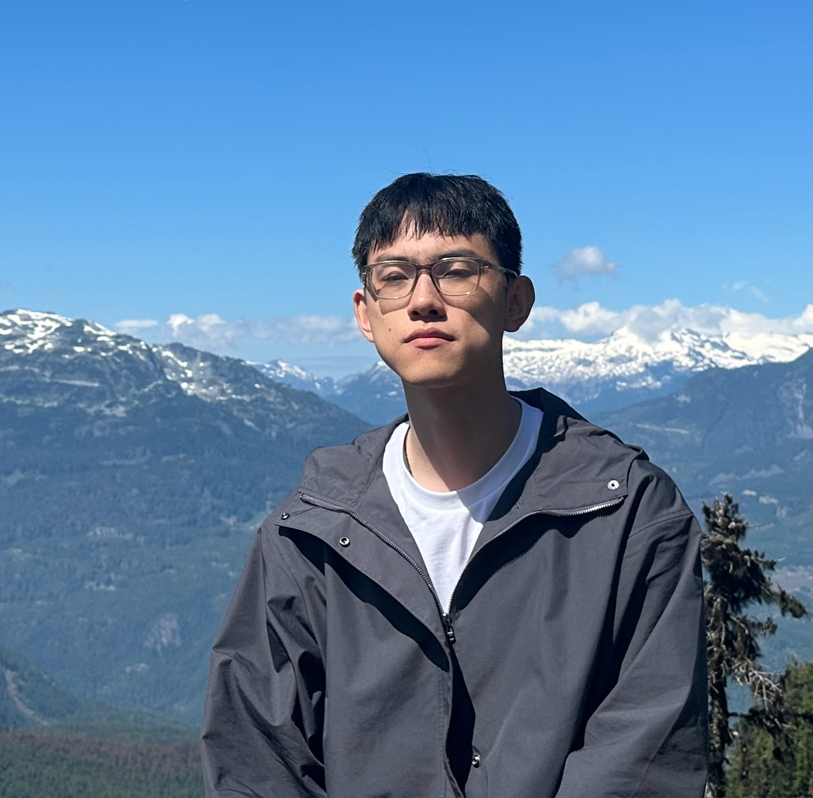

<!doctype html><html lang="zh-CN"><head><meta charset="utf-8"><meta name="viewport" content="width=device-width,initial-scale=1"><title>魏晨 — 研究与创业</title><link rel="stylesheet" href="/assets/css/personal-refined.css?v=20261116"></head><body>
<header>
<a class="brand" href="#about">CHEN WEI / 魏晨</a><nav class="nav" id="main-nav" aria-label="主导航"><a href="#about">简介</a><a href="#research">研究</a><a href="#publications">论文</a><a href="#experience">经历</a></nav><nav class="languages" aria-label="网站语言"><a href="/" lang="en" >EN</a>/<a href="/zh/" lang="zh-CN" aria-current="page">中文</a></nav><button class="menu-button" aria-controls="main-nav" aria-expanded="false">菜单</button>
</header>

<aside><h2>魏晨</h2>
全域智能创始人、CEO

中国 · 深圳

chen.wei@omni-intel.cn<a href="https://scholar.google.com/citations?user=9-MdqPkAAAAJ">Google Scholar</a><a href="https://github.com/HEDGES0-0">GitHub</a><a href="https://orcid.org/0000-0003-2999-2771">ORCID</a>

研究大脑，构建交互。
</aside>
<main><section class="hero" id="about">
脑机接口基础模型 · 生成模型与闭环交互 · 认知建模与智能体
<h1>理解大脑表征， 探索人机交互。</h1>
我是魏晨，全域智能创始人兼 CEO。我的研究聚焦脑机接口基础模型、生成模型与闭环交互、认知建模与智能体三个方向。

在 Nature Biomedical Engineering、NeurIPS、ICML、ICLR、IJCAI、ACM MM 等顶级期刊与会议发表论文，其中以一作或通讯作者发表 18 篇，Google Scholar 总引用超过 1,000 次。担任 ICLR、ICML 领域主席（Area Chair）。合著《人脑智能与人工智能》（清华大学出版社，2025）。

<a href="#research">代表成果</a><a href="/assets/files/CV_魏晨.pdf">下载简历 · PDF</a>

01<h3>脑机接口基础模型</h3>
神经信号建模，以及与视觉、语言的多模态对齐。

02<h3>生成模型与闭环交互</h3>
以脑电为反馈，生成刺激、解码感知并构建交互。

03<h3>认知建模与智能体</h3>
研究模型表征、个体差异与人机决策行为。

</section>
<section id="research">
<h2>代表成果</h2><a href="#publications">完整论文列表 →</a>
<article class="feature">
NeurIPS2026

<h3>Neuro-KE</h3>
以知识引导 EEG 基础模型的语义对齐。

</article><article class="feature">
Nature Biomedical Engineering2026

<h3>GBF</h3>
用几何约束重建全脑时空动态，为无创脑功能成像提供更精细的表征。
<a href="https://www.nature.com/articles/s41551-026-01664-0">论文</a>
</article><article class="feature">
ICLR2026

<h3>MindPilot</h3>
用脑电反馈引导视觉刺激生成，探索闭环脑机交互。
<a href="https://proceedings.iclr.cc/paper_files/paper/2026/hash/b4dde7f1bc45bf9c0fda8db8f272b758-Abstract-Conference.html">论文</a>
</article><article class="feature">
ICML2025

<h3>BAM</h3>
生成感知边界图像，理解并调控个体之间的感知差异。
<a href="https://arxiv.org/abs/2505.03641">论文</a>
</article><article class="feature">
NeurIPS2024

<h3>ATM</h3>
将脑电表征与扩散模型连接，实现视觉解码和图像重建。
<a href="https://papers.nips.cc/paper_files/paper/2024/hash/ba5f1233efa77787ff9ec015877dbd1f-Abstract-Conference.html">论文</a><a href="https://github.com/dongyangli-del/EEG_Image_decode">代码</a>
</article></section>
<section id="publications">
<h2>论文</h2>25 篇

<button type="button" data-filter="all" aria-pressed="true">全部</button><button type="button" data-filter="2026" aria-pressed="false">2026</button><button type="button" data-filter="2025" aria-pressed="false">2025</button><button type="button" data-filter="2024" aria-pressed="false">2024</button><button type="button" data-filter="2022" aria-pressed="false">2022</button><button type="button" data-filter="2021" aria-pressed="false">2021</button>

* 同等贡献 · † 通讯作者

2026

<article class="paper"><h3>Neuro-KE: Knowledge-Guided Interfaces for Semantically Grounded EEG Foundation Models</h3>
Hanrui Chen, Xiang Chen, Haotian Deng, Kexin Lou, Shinan Wang, <strong>Chen Wei</strong>†, Quanying Liu

NeurIPS, 2026.
</article><article class="paper"><h3>Scale-Invariance in AI Representation Predicts AI-Brain Alignment</h3>
Junjie Yu, Wenxiao Ma, <strong>Chen Wei</strong>, Jianyu Zhang, Haotian Deng, Zihan Deng, Yi Guo, Quanying Liu

ICML, 2026.
</article><article class="paper"><h3>Generalization Error Bound via Embedding Dimension and Network Lipschitz Constant</h3>
Junjie Yu, Zhuoli Ouyang, Haotian Deng, <strong>Chen Wei</strong>, Wenxiao Ma, Jianyu Zhang, Zihan Deng, Yi Guo, Quanying Liu

ICML, 2026.
</article><article class="paper"><h3>When Agents Steer Human Perception: How AI-Selected Images Can Covertly Alter Judgment Disagreements</h3>
Chi Zhang*, Yulang Gao*, Jiachen Zou, <strong>Chen Wei</strong>†, Quanying Liu†

CVPR Findings, 2026.<a href="https://openaccess.thecvf.com/content/CVPR2026F/html/Zhang_When_Agents_Steer_Human_Perception_How_AI-Selected_Images_Can_Convertly_CVPRF_2026_paper.html">论文</a>
</article><article class="paper"><h3>MindPilot: Closed-loop Visual Stimulation Optimization for Brain Modulation with EEG-guided Diffusion</h3>
Dongyang Li, Kunpeng Xie, Mingyang Wu, Yiwei Kong, Jiahua Tang, Haoyang Qin, <strong>Chen Wei</strong>†, Quanying Liu†

ICLR, 2026.<a href="https://proceedings.iclr.cc/paper_files/paper/2026/hash/b4dde7f1bc45bf9c0fda8db8f272b758-Abstract-Conference.html">论文</a>
</article><article class="paper"><h3>A geometry aware framework enhances noninvasive mapping of whole human brain dynamics</h3>
Song Wang*, Kexin Lou*, <strong>Chen Wei</strong>*, Zhiyuan Sheng, Jiahao Tang, Kaining Peng, Xinke Shen, Shuhao Mei, Liang Chen, Dongfeng Gu, Quanying Liu

Nature Biomedical Engineering, 2026.<a href="https://www.nature.com/articles/s41551-026-01664-0">论文</a>
</article><article class="paper"><h3>When Proxy Agents Disagree, Do Humans Mirror? Manipulating Human Behavior in Moral Dilemmas through Agents</h3>
Haotian Deng, Sitian Wang, Ruxin Wang, <strong>Chen Wei</strong>†, Quanying Liu†

AAAI Artificial Intelligence for Social Impact Track, 2026.<a href="https://ojs.aaai.org/index.php/AAAI/article/view/41176">论文</a>
</article>

2025

<article class="paper"><h3>When LLM Agents Disagree, Do Humans Mirror? Behavioral Comparisons on Moral Dilemmas</h3>
Haotian Deng, Sitian Wang, Ruxin Wang, Xuetao Wei, <strong>Chen Wei</strong>†, Quanying Liu†

MIND (Oral) (最佳论文奖提名), 2025.<a href="https://doi.org/10.1109/MIND67540.2025.11351781">论文</a>
</article><article class="paper"><h3>Using AI-generated real-world objects to uncover the structure of visual memory</h3>
Jiachen Zou, <strong>Chen Wei</strong>, Quanying Liu, M Robinson

Journal of Vision, 2025.<a href="https://doi.org/10.1167/jov.25.9.2037">论文</a>
</article><article class="paper"><h3>BrainFLORA: Uncovering Brain Concept Representation via Multimodal Neural Embeddings</h3>
Dongyang Li, Haoyang Qin, Mingyang Wu, <strong>Chen Wei</strong>†, Quanying Liu†

ACM MM (Oral), 2025.<a href="https://arxiv.org/abs/2507.09747">论文</a><a href="https://github.com/ncclab-sustech/BrainFLORA">代码</a>
</article><article class="paper"><h3>Synthesizing Images on Perceptual Boundaries of ANNs for Uncovering and Manipulating Human Perceptual Variability</h3>
<strong>Chen Wei</strong>*, Chi Zhang*, Jiachen Zou, Haotian Deng, Dietmar Heinke, Quanying Liu

ICML, 2025.<a href="https://arxiv.org/abs/2505.03641">论文</a>
</article><article class="paper"><h3>Dimensions of Vulnerability in Visual Working Memory: An AI-Driven Approach to Perceptual Comparison</h3>
Yuang Cao*, Jiachen Zou*, <strong>Chen Wei</strong>†, Quanying Liu†

CogSci, 2025.<a href="https://arxiv.org/abs/2507.22067">论文</a>
</article><article class="paper"><h3>Synthesizing Images on Perceptual Boundaries of ANNs for Uncovering Human Perceptual Variability on Facial Expressions</h3>
Haotian Deng*, Chi Zhang*, <strong>Chen Wei</strong>†, Quanying Liu†

IJCNN (Oral), 2025.<a href="https://arxiv.org/abs/2507.14549">论文</a>
</article><article class="paper"><h3>Uncovering the EEG Temporal Representation of Low-dimensional Object Properties</h3>
Jiahua Tang, Song Wang, Jiachen Zou, <strong>Chen Wei</strong>†, Quanying Liu†

IJCNN (Oral), 2025.<a href="https://arxiv.org/abs/2507.14537">论文</a>
</article><article class="paper"><h3>RealMind: Advancing Visual Decoding and Language Interaction via EEG Signals</h3>
Dongyang Li, Haoyang Qin, Mingyang Wu, Jiahua Tang, <strong>Chen Wei</strong>†, Quanying Liu†

ICME (Oral), 2025.<a href="https://arxiv.org/abs/2410.23754">论文</a>
</article>

2024

<article class="paper"><h3>Visual Decoding and Reconstruction via EEG Embeddings with Guided Diffusion</h3>
Dongyang Li*, <strong>Chen Wei</strong>*, Shiying Li, Jiachen Zou, Quanying Liu

NeurIPS, 2024.<a href="https://papers.nips.cc/paper_files/paper/2024/hash/ba5f1233efa77787ff9ec015877dbd1f-Abstract-Conference.html">论文</a><a href="https://github.com/dongyangli-del/EEG_Image_decode">代码</a>
</article><article class="paper"><h3>CoCoG-2: Controllable generation of visual stimuli for understanding human concept representation</h3>
<strong>Chen Wei</strong>*, Jiachen Zou*, Dietmar Heinke, Quanying Liu

IJCAI Workshop on Human Brain and Artificial Intelligence, Oral, 2024. 最佳论文奖。<a href="https://arxiv.org/abs/2407.14949">论文</a><a href="https://github.com/ncclab-sustech/CoCoG-2">代码</a>
</article><article class="paper"><h3>CoCoG: Controllable Visual Stimuli Generation based on Human Concept Representations</h3>
<strong>Chen Wei</strong>*, Jiachen Zou*, Dietmar Heinke, Quanying Liu

IJCAI (Oral), 2024.<a href="https://arxiv.org/abs/2404.16482">论文</a>
</article><article class="paper"><h3>Promoting interactions between cognitive science and large language models</h3>
Youzhi Qu, Penghui Du, Wenxin Che, <strong>Chen Wei</strong>, Chi Zhang, Wanli Ouyang, Yatao Bian, Feiyang Xu, Bin Hu, Kai Du, et al

The Innovation, 2024.<a href="https://doi.org/10.1016/j.xinn.2024.100579">论文</a>
</article><article class="paper"><h3>Integration of cognitive tasks into artificial general intelligence test for large models</h3>
Youzhi Qu*, <strong>Chen Wei</strong>*, Penghui Du, Wenxin Che, Chi Zhang, Wanli Ouyang, Yatao Bian, Feiyang Xu, Bin Hu, Kai Du, et al

iScience, 2024.<a href="https://arxiv.org/abs/2402.02547">论文</a>
</article><article class="paper"><h3>Advancing EEG/MEG Source Imaging with Geometric-Informed Basis Functions</h3>
Song Wang, <strong>Chen Wei</strong>, Kexin Lou, Dongfeng Gu, Quanying Liu

EMBC, 2024.<a href="https://arxiv.org/abs/2401.17939">论文</a>
</article>

2022

<article class="paper"><h3>Embedding decomposition for artifacts removal in EEG signals</h3>
Junjie Yu, Chenyi Li, Kexin Lou, <strong>Chen Wei</strong>, Quanying Liu

Journal of Neural Engineering, 2022.<a href="https://doi.org/10.1088/1741-2552/ac63eb">论文</a>
</article>

2021

<article class="paper"><h3>EEGdenoiseNet: A benchmark dataset for deep learning solutions of EEG denoising</h3>
Haoming Zhang*, Mingqi Zhao*, <strong>Chen Wei</strong>, Dante Mantini, Zherui Li, Quanying Liu

Journal of Neural Engineering, 2021.<a href="https://doi.org/10.1088/1741-2552/ac2bf8">论文</a><a href="https://github.com/ncclabsustech/EEGdenoiseNet">代码</a>
</article><article class="paper"><h3>Edge Sparse Basis Network: A Deep Learning Framework for EEG Source Localization</h3>
<strong>Chen Wei</strong>*, Kexin Lou*, Zhengyang Wang, Mingqi Zhao, Dante Mantini, Quanying Liu

IJCNN (Oral), 2021.<a href="https://arxiv.org/abs/2102.09188">论文</a>
</article><article class="paper"><h3>A novel convolutional neural network model to remove muscle artifacts from EEG</h3>
Haoming Zhang*, <strong>Chen Wei</strong>*, Mingqi Zhao, Quanying Liu, Haiyan Wu

ICASSP, 2021.<a href="https://arxiv.org/abs/2010.11709">论文</a>
</article>

</section>
<section id="experience" class="experience">
<h2>经历</h2><a href="/assets/files/CV_魏晨.pdf">完整简历 ↗</a>
<h4>工作经历</h4><h3>2025–至今 | 创始人、CEO | 深圳全域智能科技有限公司</h3>

模型研发：组织团队完成脑电基座模型的数据采集、训练、评测与部署，构建目前最大的脑电基座模型。

数据体系：搭建全球首个规模化神经数据采集体系，支持脑机接口基础模型的持续训练与迭代。

公司运营：全面负责公司日常运营，包括团队建设、资源配置与业务推进。

<h3>2019–2021 | 研究助理 | 南方科技大学</h3>

神经计算与控制实验室，导师：刘泉影教授。 开展数据驱动的脑机接口研究。
<h4>教育背景</h4><h3>2021–2025 | 博士（联合培养项目）</h3>

<strong>伯明翰大学</strong>（学位授予单位），英国；导师：Dietmar Heinke 教授。

<strong>南方科技大学</strong>，中国深圳；导师：刘泉影教授，神经计算与控制实验室。

<h3>2014–2018 | 金融学学士 | 西南财经大学</h3></section>
<section id="more">
<h2>更多经历</h2>

科研项目

2026.10.01 —  2028.09.30 <strong>高精度无创脑机接口器件与解码关键技术项目</strong> —  中华人民共和国工业和信息化部科技司，2026 年项目 —  项目编号：ZC26T320065-208 —  880 万元｜在研，参与

2025.08.01 —  2028.07.31 <strong>外骨骼具身智能体关键技术研究及应用</strong> —  广东省科学技术厅，广东省重点领域研发计划项目 —  项目编号：2026B0101110003 —  50 万元｜在研，参与

2025.09 —  2028.08 <strong>可预测可干预因果仿真孪生脑建模技术研究</strong> —  科学技术部，国家重点研发计划项目 —  项目编号：2025YFC3410003 —  150 万元｜在研，参与

2026.09 —  2030.12 <strong>高性能强泛化的脑信号解码基座大模型</strong> —  国家自然科学基金委员会，脑科学与类脑研究国家科技重大专项 —  项目编号：2026ZD0220402 —  377.61 万元｜在研，参与

书籍

[1] 刘泉影, 曲由之, 魏晨, 梁智超. 《人脑智能与人工智能》. 北京: 清华大学出版社, 2025.

[2] Quanying Liu, Chen Wei, Youzhi Qu, Zhichao Liang. “Modelling and Controlling System Dynamics of the Brain: An Intersection of Machine Learning and Control Theory.” In Systems Neuroscience, Springer Nature, 2024: 63-87.

专利

[1] 刘泉影; 魏晨; 邹佳辰; 李东洋; 基于脑电的图像生成方法、装置、计算机设备及存储介质, 2023-10-27, 中国, 202311417449.3

[2] 刘泉影; 魏晨; 李诗颖; 脑机接口想象标志物设计方法、装置、设备及存储介质, 2023-8-15, 中国, 202311031985.X

[3] 刘泉影; 魏晨; 楼可心; 一种脑电溯源模型的训练方法，脑电溯源方法及电子设备, 2021-4-30, 中国, 2021104889005

学术服务

<strong>领域主席：</strong>ICLR、ICML

<strong>客座编辑：</strong>Tsinghua Science and Technology 专题 “Foundation Models for Brain Science”

<strong>会议审稿：</strong>NeurIPS；ICML；ICLR；AISTATS；AAAI, CogSci；ACMMM；IJCNN; AAAI Artificial Intelligence for Social Impact Track; IJCAI Workshop on Human Brain and Artificial Intelligence

<strong>期刊审稿：</strong>iScience; Neuroscience; Machine Learning: Science and Technology；Journal of Neural Engineering; Biomedical Physics &amp; Engineering Express

<strong>学术会员：</strong>IEEE 会员；英国物理学会（IOP）准会员

教学经历

助教 —  2023 机器学习与医学工程应用｜南方科技大学 / 授课老师：刘泉影

助教 —  2023 大脑智能与人工智能｜南方科技大学 / 授课老师：刘泉影

助教 —  2023 脑信号分析与特征提取训练营（深度学习与人工智能专题）｜中国科学院心理研究所 / 授课老师：刘泉影

受邀报告

2026.11 2026 中国多智能体应用大会，“驭智·脑机接口与具身智能”专题会讲者。

Dec 2024 Understanding and Manipulating Human Perception by Generating Visual Stimuli。德国马克斯·普朗克研究所 &amp; 吉森大学 (邀请人: Martin Hebert)

Aug 2024 CoCoG: Controllable Visual Stimuli Generation Based on Human Concept Representations。IJCAI

Aug 2024 CoCoG-2: Controllable generation of visual stimuli for understanding human concept representation。IJCAI Workshop on Human Brain and Artificial Intelligence

Jun 2024 Using Visual Generation Models to Enhance Psychological Experimental Design。AI4Psych Seminar

May 2024 Controllable Visual Stimuli Generation Based on Human Concept Representations。清华大学 (邀请人: 张丹)

May 2021 Edge Sparse Basis Network。IJCNN

奖项

2024 2024 年 IOP 高被引论文奖

2024 IOP 可信审稿人

2024 国际人工智能联合会议人脑与人工智能研讨会（IJCAI-HBAI workshop）最佳论文奖

2023 南方科技大学生物医学工程研究日海报展示优秀奖

2020 广东省研究生学术论坛——生物医学工程脑科学分论坛一等奖

其他经历

译著 Farrell S., Lewandowsky S. Computational Modeling of Cognition and Behavior. Cambridge University Press, 2018.（中文版译者之一）

科普活动 2024年7月在深圳科学馆组织8场青少年AI科普讲座，参与人数超3000人

</section><footer>© 魏晨<a href="/assets/files/CV_ChenWei.pdf">English CV</a> · <a href="/assets/files/CV_魏晨.pdf">中文简历</a> · <a href="#about">回到顶部 ↑</a></footer></main>

</body></html>