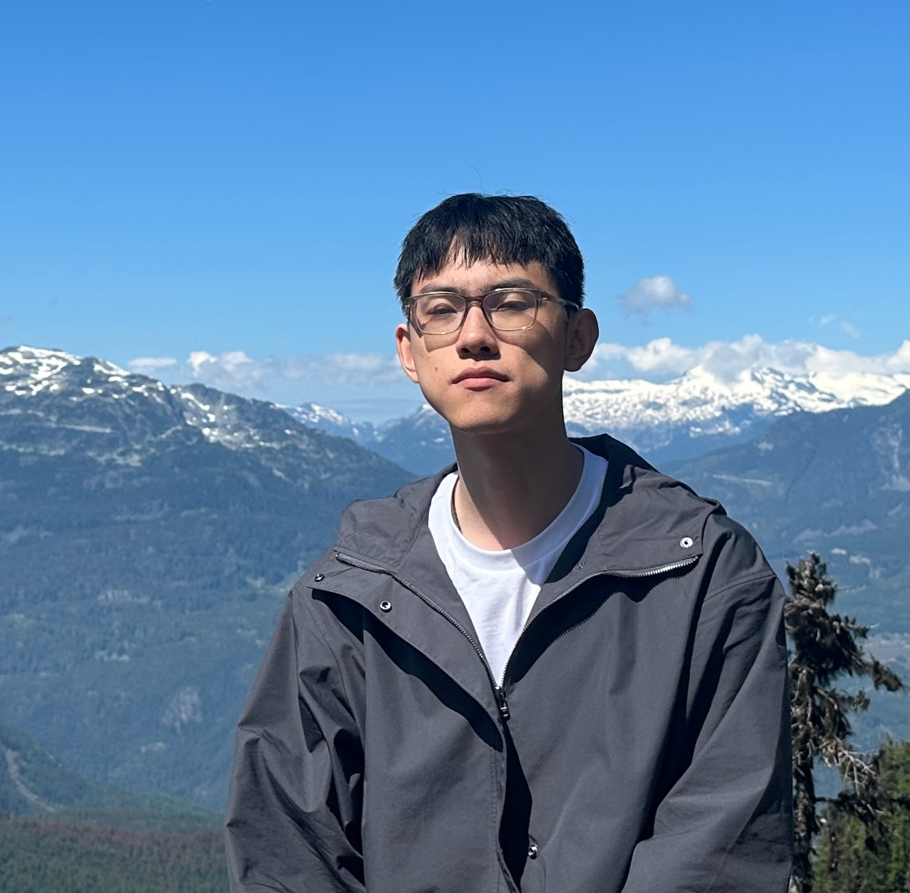

<!doctype html><html lang="en"><head><meta charset="utf-8"><meta name="viewport" content="width=device-width,initial-scale=1"><title>Chen Wei — Research & Entrepreneurship</title><link rel="stylesheet" href="/assets/css/personal-refined.css?v=company-6"></head><body>
<header>
<a class="brand" href="#about">CHEN WEI / Research</a><nav class="nav" id="main-nav" aria-label="Main navigation"><a href="#about">About</a><a href="#research">Research</a><a href="#publications">Publications</a><a href="#experience">Experience</a></nav><nav class="languages" aria-label="Website language"><a href="/" lang="en" aria-current="page">EN</a>/<a href="/zh/" lang="zh-CN" >中文</a></nav><button class="menu-button" aria-controls="main-nav" aria-expanded="false">Menu</button>
</header>

<aside><h2>Chen Wei</h2>
Founder & CEO <a href="https://omni-intel.cn/">Omni-intelligence</a>

Shenzhen, China

chen.wei@omni-intel.cn<a href="https://scholar.google.com/citations?user=9-MdqPkAAAAJ">Google Scholar</a><a href="https://github.com/HEDGES0-0">GitHub</a><a href="https://orcid.org/0000-0003-2999-2771">ORCID</a>

<figure><figcaption>Company website</figcaption></figure><figure><figcaption>WeChat official account</figcaption></figure>

Understand Human in Every Silent Moment
</aside>
<main><section class="hero" id="about">
BCI foundation models · Generative neural interaction · Cognition & agents
<h1>Understand Human Beyond Words</h1>
I’m Chen Wei, founder and CEO of <a href="https://omni-intel.cn/">Omni-intelligence</a>. My research focuses on BCI foundation models, generative neural interaction, and cognition and agents.

My work has appeared in Nature Biomedical Engineering, NeurIPS, ICML, ICLR, IJCAI and ACM MM, including 18 first- or corresponding-author papers, with over 1,000 Google Scholar citations. I serve as an Area Chair for ICLR and ICML. I co-authored Human Brain Intelligence and Artificial Intelligence (Tsinghua University Press, 2025).

<a href="#research">Selected research</a><a href="/assets/files/CV_ChenWei.pdf">Download CV · PDF</a>

01<h3>BCI foundation models</h3>
Neural signal modeling and alignment with vision and language.

02<h3>Generative neural interaction</h3>
EEG-guided generation, visual decoding and closed-loop interaction.

03<h3>Cognition & agents</h3>
Model representations, individual differences and human–AI decisions.

</section>
<section id="research">
<h2>Selected research</h2><a href="#publications">All publications →</a>
<article class="feature">
NeurIPS2026

<h3>Neuro-KE</h3>
Knowledge-guided semantic alignment for EEG foundation models.

</article><article class="feature">
Nature Biomedical Engineering2026

<h3>GBF</h3>
Geometric constraints for reconstructing whole-brain spatiotemporal dynamics.
<a href="https://www.nature.com/articles/s41551-026-01664-0">Paper</a>
</article><article class="feature">
ICLR2026

<h3>MindPilot</h3>
EEG-guided visual stimulus generation for closed-loop brain modulation.
<a href="https://proceedings.iclr.cc/paper_files/paper/2026/hash/b4dde7f1bc45bf9c0fda8db8f272b758-Abstract-Conference.html">Paper</a>
</article><article class="feature">
ICML2025

<h3>BAM</h3>
Boundary image generation to understand and modulate perceptual differences.
<a href="https://arxiv.org/abs/2505.03641">Paper</a>
</article><article class="feature">
NeurIPS2024

<h3>ATM</h3>
EEG embeddings with guided diffusion for visual decoding and reconstruction.
<a href="https://papers.nips.cc/paper_files/paper/2024/hash/ba5f1233efa77787ff9ec015877dbd1f-Abstract-Conference.html">Paper</a><a href="https://github.com/dongyangli-del/EEG_Image_decode">Code</a>
</article></section>
<section id="publications">
<h2>Publications</h2>25 publications

<button type="button" data-filter="all" aria-pressed="true">All</button><button type="button" data-filter="2026" aria-pressed="false">2026</button><button type="button" data-filter="2025" aria-pressed="false">2025</button><button type="button" data-filter="2024" aria-pressed="false">2024</button><button type="button" data-filter="2022" aria-pressed="false">2022</button><button type="button" data-filter="2021" aria-pressed="false">2021</button>

* Equal contribution · † Corresponding author

2026

<article class="paper"><h3>Neuro-KE: Knowledge-Guided Interfaces for Semantically Grounded EEG Foundation Models</h3>
Hanrui Chen, Xiang Chen, Haotian Deng, Kexin Lou, Shinan Wang, <strong>Chen Wei</strong>†, Quanying Liu

NeurIPS, 2026.
</article><article class="paper"><h3>Scale-Invariance in AI Representation Predicts AI-Brain Alignment</h3>
Junjie Yu, Wenxiao Ma, <strong>Chen Wei</strong>, Jianyu Zhang, Haotian Deng, Zihan Deng, Yi Guo, Quanying Liu

ICML, 2026.
</article><article class="paper"><h3>Generalization Error Bound via Embedding Dimension and Network Lipschitz Constant</h3>
Junjie Yu, Zhuoli Ouyang, Haotian Deng, <strong>Chen Wei</strong>, Wenxiao Ma, Jianyu Zhang, Zihan Deng, Yi Guo, Quanying Liu

ICML, 2026.
</article><article class="paper"><h3>When Agents Steer Human Perception: How AI-Selected Images Can Covertly Alter Judgment Disagreements</h3>
Chi Zhang*, Yulang Gao*, Jiachen Zou, <strong>Chen Wei</strong>†, Quanying Liu†

CVPR Findings, 2026.<a href="https://openaccess.thecvf.com/content/CVPR2026F/html/Zhang_When_Agents_Steer_Human_Perception_How_AI-Selected_Images_Can_Convertly_CVPRF_2026_paper.html">Paper</a>
</article><article class="paper"><h3>MindPilot: Closed-loop Visual Stimulation Optimization for Brain Modulation with EEG-guided Diffusion</h3>
Dongyang Li, Kunpeng Xie, Mingyang Wu, Yiwei Kong, Jiahua Tang, Haoyang Qin, <strong>Chen Wei</strong>†, Quanying Liu†

ICLR, 2026.<a href="https://proceedings.iclr.cc/paper_files/paper/2026/hash/b4dde7f1bc45bf9c0fda8db8f272b758-Abstract-Conference.html">Paper</a>
</article><article class="paper"><h3>A geometry aware framework enhances noninvasive mapping of whole human brain dynamics</h3>
Song Wang*, Kexin Lou*, <strong>Chen Wei</strong>*, Zhiyuan Sheng, Jiahao Tang, Kaining Peng, Xinke Shen, Shuhao Mei, Liang Chen, Dongfeng Gu, Quanying Liu

Nature Biomedical Engineering, 2026.<a href="https://www.nature.com/articles/s41551-026-01664-0">Paper</a>
</article><article class="paper"><h3>When Proxy Agents Disagree, Do Humans Mirror? Manipulating Human Behavior in Moral Dilemmas through Agents</h3>
Haotian Deng, Sitian Wang, Ruxin Wang, <strong>Chen Wei</strong>†, Quanying Liu†

AAAI Artificial Intelligence for Social Impact Track, 2026.<a href="https://ojs.aaai.org/index.php/AAAI/article/view/41176">Paper</a>
</article>

2025

<article class="paper"><h3>When LLM Agents Disagree, Do Humans Mirror? Behavioral Comparisons on Moral Dilemmas</h3>
Haotian Deng, Sitian Wang, Ruxin Wang, Xuetao Wei, <strong>Chen Wei</strong>†, Quanying Liu†

MIND (Oral) (Best Paper Finalist), 2025.<a href="https://doi.org/10.1109/MIND67540.2025.11351781">Paper</a>
</article><article class="paper"><h3>Using AI-generated real-world objects to uncover the structure of visual memory</h3>
Jiachen Zou, <strong>Chen Wei</strong>, Quanying Liu, M Robinson

Journal of Vision, 2025.<a href="https://doi.org/10.1167/jov.25.9.2037">Paper</a>
</article><article class="paper"><h3>BrainFLORA: Uncovering Brain Concept Representation via Multimodal Neural Embeddings</h3>
Dongyang Li, Haoyang Qin, Mingyang Wu, <strong>Chen Wei</strong>†, Quanying Liu†

ACM MM (Oral), 2025.<a href="https://arxiv.org/abs/2507.09747">Paper</a><a href="https://github.com/ncclab-sustech/BrainFLORA">Code</a>
</article><article class="paper"><h3>Synthesizing Images on Perceptual Boundaries of ANNs for Uncovering and Manipulating Human Perceptual Variability</h3>
<strong>Chen Wei</strong>*, Chi Zhang*, Jiachen Zou, Haotian Deng, Dietmar Heinke, Quanying Liu

ICML, 2025.<a href="https://arxiv.org/abs/2505.03641">Paper</a>
</article><article class="paper"><h3>Dimensions of Vulnerability in Visual Working Memory: An AI-Driven Approach to Perceptual Comparison</h3>
Yuang Cao*, Jiachen Zou*, <strong>Chen Wei</strong>†, Quanying Liu†

CogSci, 2025.<a href="https://arxiv.org/abs/2507.22067">Paper</a>
</article><article class="paper"><h3>Synthesizing Images on Perceptual Boundaries of ANNs for Uncovering Human Perceptual Variability on Facial Expressions</h3>
Haotian Deng*, Chi Zhang*, <strong>Chen Wei</strong>†, Quanying Liu†

IJCNN (Oral), 2025.<a href="https://arxiv.org/abs/2507.14549">Paper</a>
</article><article class="paper"><h3>Uncovering the EEG Temporal Representation of Low-dimensional Object Properties</h3>
Jiahua Tang, Song Wang, Jiachen Zou, <strong>Chen Wei</strong>†, Quanying Liu†

IJCNN (Oral), 2025.<a href="https://arxiv.org/abs/2507.14537">Paper</a>
</article><article class="paper"><h3>RealMind: Advancing Visual Decoding and Language Interaction via EEG Signals</h3>
Dongyang Li, Haoyang Qin, Mingyang Wu, Jiahua Tang, <strong>Chen Wei</strong>†, Quanying Liu†

ICME (Oral), 2025.<a href="https://arxiv.org/abs/2410.23754">Paper</a>
</article>

2024

<article class="paper"><h3>Visual Decoding and Reconstruction via EEG Embeddings with Guided Diffusion</h3>
Dongyang Li*, <strong>Chen Wei</strong>*, Shiying Li, Jiachen Zou, Quanying Liu

NeurIPS, 2024.<a href="https://papers.nips.cc/paper_files/paper/2024/hash/ba5f1233efa77787ff9ec015877dbd1f-Abstract-Conference.html">Paper</a><a href="https://github.com/dongyangli-del/EEG_Image_decode">Code</a>
</article><article class="paper"><h3>CoCoG-2: Controllable generation of visual stimuli for understanding human concept representation</h3>
<strong>Chen Wei</strong>*, Jiachen Zou*, Dietmar Heinke, Quanying Liu

IJCAI Workshop on Human Brain and Artificial Intelligence, Oral, 2024. Best Paper Award.<a href="https://arxiv.org/abs/2407.14949">Paper</a><a href="https://github.com/ncclab-sustech/CoCoG-2">Code</a>
</article><article class="paper"><h3>CoCoG: Controllable Visual Stimuli Generation based on Human Concept Representations</h3>
<strong>Chen Wei</strong>*, Jiachen Zou*, Dietmar Heinke, Quanying Liu

IJCAI (Oral), 2024.<a href="https://arxiv.org/abs/2404.16482">Paper</a>
</article><article class="paper"><h3>Promoting interactions between cognitive science and large language models</h3>
Youzhi Qu, Penghui Du, Wenxin Che, <strong>Chen Wei</strong>, Chi Zhang, Wanli Ouyang, Yatao Bian, Feiyang Xu, Bin Hu, Kai Du, et al

The Innovation, 2024.<a href="https://doi.org/10.1016/j.xinn.2024.100579">Paper</a>
</article><article class="paper"><h3>Integration of cognitive tasks into artificial general intelligence test for large models</h3>
Youzhi Qu*, <strong>Chen Wei</strong>*, Penghui Du, Wenxin Che, Chi Zhang, Wanli Ouyang, Yatao Bian, Feiyang Xu, Bin Hu, Kai Du, et al

iScience, 2024.<a href="https://arxiv.org/abs/2402.02547">Paper</a>
</article><article class="paper"><h3>Advancing EEG/MEG Source Imaging with Geometric-Informed Basis Functions</h3>
Song Wang, <strong>Chen Wei</strong>, Kexin Lou, Dongfeng Gu, Quanying Liu

EMBC, 2024.<a href="https://arxiv.org/abs/2401.17939">Paper</a>
</article>

2022

<article class="paper"><h3>Embedding decomposition for artifacts removal in EEG signals</h3>
Junjie Yu, Chenyi Li, Kexin Lou, <strong>Chen Wei</strong>, Quanying Liu

Journal of Neural Engineering, 2022.<a href="https://doi.org/10.1088/1741-2552/ac63eb">Paper</a>
</article>

2021

<article class="paper"><h3>EEGdenoiseNet: A benchmark dataset for deep learning solutions of EEG denoising</h3>
Haoming Zhang*, Mingqi Zhao*, <strong>Chen Wei</strong>, Dante Mantini, Zherui Li, Quanying Liu

Journal of Neural Engineering, 2021.<a href="https://doi.org/10.1088/1741-2552/ac2bf8">Paper</a><a href="https://github.com/ncclabsustech/EEGdenoiseNet">Code</a>
</article><article class="paper"><h3>Edge Sparse Basis Network: A Deep Learning Framework for EEG Source Localization</h3>
<strong>Chen Wei</strong>*, Kexin Lou*, Zhengyang Wang, Mingqi Zhao, Dante Mantini, Quanying Liu

IJCNN (Oral), 2021.<a href="https://arxiv.org/abs/2102.09188">Paper</a>
</article><article class="paper"><h3>A novel convolutional neural network model to remove muscle artifacts from EEG</h3>
Haoming Zhang*, <strong>Chen Wei</strong>*, Mingqi Zhao, Quanying Liu, Haiyan Wu

ICASSP, 2021.<a href="https://arxiv.org/abs/2010.11709">Paper</a>
</article>

</section>
<section id="experience" class="experience">
<h2>Experience</h2><a href="/assets/files/CV_ChenWei.pdf">Full CV ↗</a>
<h4>WORK</h4><h3>2025–present | Founder and CEO | <a href="https://omni-intel.cn/">Shenzhen Omni-intelligence Co., Ltd.</a></h3>

Model development: led the team in data collection, training, evaluation and deployment to build the largest EEG foundation model to date.

Data infrastructure: established the world&#x27;s first large-scale neural data collection system to support continuous training and iteration of BCI foundation models.

Company operations: oversee day-to-day operations, including team building, resource allocation and business development.

<h3>2019–2021 | Research Assistant | Southern University of Science and Technology</h3>

Neural Computation and Control Laboratory, Supervisor: Prof. Quanying Liu. Conducted data-driven BCI research.
<h4>EDUCATION</h4><h3>2021–2025 | Ph.D. (Joint Program)</h3>

<strong>University of Birmingham</strong> (degree-awarding institution), UK; Supervisor: Prof. Dietmar Heinke.

<strong>Southern University of Science and Technology</strong>, Shenzhen, China; Supervisor: Prof. Quanying Liu, Neural Computation and Control Laboratory.

<h3>2014–2018 | Bachelor&#x27;s in Finance | Southwestern University of Finance and Economics</h3></section>
<section id="more">
<h2>Beyond research</h2>

Research projects

2026.10.01 —  2028.09.30 <strong>High-Precision Non-Invasive BCI Devices and Key Decoding Technologies</strong> —  Department of Science and Technology, Ministry of Industry and Information Technology, China; 2026 project —  Project ID: ZC26T320065-208 —  RMB 8.8 million | Ongoing; participant

2025.08.01 —  2028.07.31 <strong>Key Technologies and Applications of Exoskeleton Embodied Agents</strong> —  Department of Science and Technology of Guangdong Province; Key-Area Research and Development Program —  Project ID: 2026B0101110003 —  RMB 0.5 million | Ongoing; participant

2025.09 —  2028.08 <strong>Predictive and Intervenable Causal-Simulation Digital-Twin Brain Modeling</strong> —  Ministry of Science and Technology; National Key Research and Development Program —  Project ID: 2025YFC3410003 —  RMB 1.5 million | Ongoing; participant

2026.09 —  2030.12 <strong>High-Performance, Generalizable Foundation Models for Brain-Signal Decoding</strong> —  National Natural Science Foundation of China; National Science and Technology Major Project for Brain Science and Brain-Inspired Research —  Project ID: 2026ZD0220402 —  RMB 3.7761 million | Ongoing; participant

Books

[1] Quanying Liu, Youzhi Qu, Chen Wei, Zhichao Liang. Human Brain Intelligence and Artificial Intelligence. Beijing: Tsinghua University Press, 2025.

[2] Quanying Liu, Chen Wei, Youzhi Qu, Zhichao Liang. “Modelling and Controlling System Dynamics of the Brain: An Intersection of Machine Learning and Control Theory.” In Systems Neuroscience, Springer Nature, 2024: 63-87.

Patents

[1] Quanying Liu; Chen Wei; Jiachen Zou; Dongyang Li; EEG-Based Image Generation Method, Apparatus, Computer Device and Storage Medium, 2023-10-27, China, 202311417449.3

[2] Quanying Liu; Chen Wei; Shiying Li; BCI Imagery Marker Design Method, Apparatus, Device and Storage Medium, 2023-8-15, China, 202311031985.X

[3] Quanying Liu; Chen Wei; Kexin Lou; Training Method for an EEG Source Localization Model, EEG Source Localization Method and Electronic Device, 2021-4-30, China, 2021104889005

Academic service

<strong>Area Chair:</strong> ICLR, ICML

<strong>Guest Editor:</strong> Tsinghua Science and Technology Special issue “Foundation Models for Brain Science”

<strong>Conference reviewing:</strong> NeurIPS; ICML; ICLR; AISTATS; AAAI, CogSci; ACMMM; IJCNN; AAAI Artificial Intelligence for Social Impact Track; IJCAI Workshop on Human Brain and Artificial Intelligence

<strong>Journal reviewing:</strong> iScience; Neuroscience; Machine Learning: Science and Technology; Journal of Neural Engineering; Biomedical Physics &amp; Engineering Express

<strong>Membership:</strong> IEEE Member; Associate Member, Institute of Physics (IOP)

Teaching

Teaching Assistant —  2023 Machine Learning and Medical Engineering Applications | Southern University of Science and Technology / Instructor: Quanying Liu

Teaching Assistant —  2023 Brain Intelligence and Artificial Intelligence | Southern University of Science and Technology / Instructor: Quanying Liu

Teaching Assistant —  2023 Brain Signal Analysis and Feature Extraction (Deep Learning and AI) | Institute of Psychology, Chinese Academy of Sciences / Instructor: Quanying Liu

Invited talks

2026.11 2026 China Multi-Agent Applications Conference, Speaker, BCI and Embodied Intelligence session.

Dec 2024 Understanding and Manipulating Human Perception by Generating Visual Stimuli. Max Planck Institute, Germany &amp; Justus Liebig University Giessen (Invited by: Martin Hebert)

Aug 2024 CoCoG: Controllable Visual Stimuli Generation Based on Human Concept Representations. IJCAI

Aug 2024 CoCoG-2: Controllable generation of visual stimuli for understanding human concept representation. IJCAI Workshop on Human Brain and Artificial Intelligence

Jun 2024 Using Visual Generation Models to Enhance Psychological Experimental Design. AI4Psych Seminar

May 2024 Controllable Visual Stimuli Generation Based on Human Concept Representations. Tsinghua University (Invited by: Dan Zhang)

May 2021 Edge Sparse Basis Network. IJCNN

Awards

2024 IOP Top Cited Paper Award

2024 IOP Trusted Reviewer

2024 Best Paper Award, IJCAI Workshop on Human Brain and Artificial Intelligence

2023 Poster Excellence Award, BME Research Day, SUSTech

2020 First Prize, Biomedical Engineering and Brain Science Session, Guangdong Graduate Academic Forum

Other experience

Translation Farrell S., Lewandowsky S. Computational Modeling of Cognition and Behavior. Cambridge University Press, 2018. (co-translator of the Chinese edition)

Science Outreach Organized eight AI lectures for young people at Shenzhen Science Museum in July 2024, reaching over 3,000 participants

</section><footer>© Chen Wei<a href="/assets/files/CV_ChenWei.pdf">English CV</a> · <a href="/assets/files/CV_魏晨.pdf">中文简历</a> · <a href="#about">Back to top ↑</a></footer></main>

</body></html>